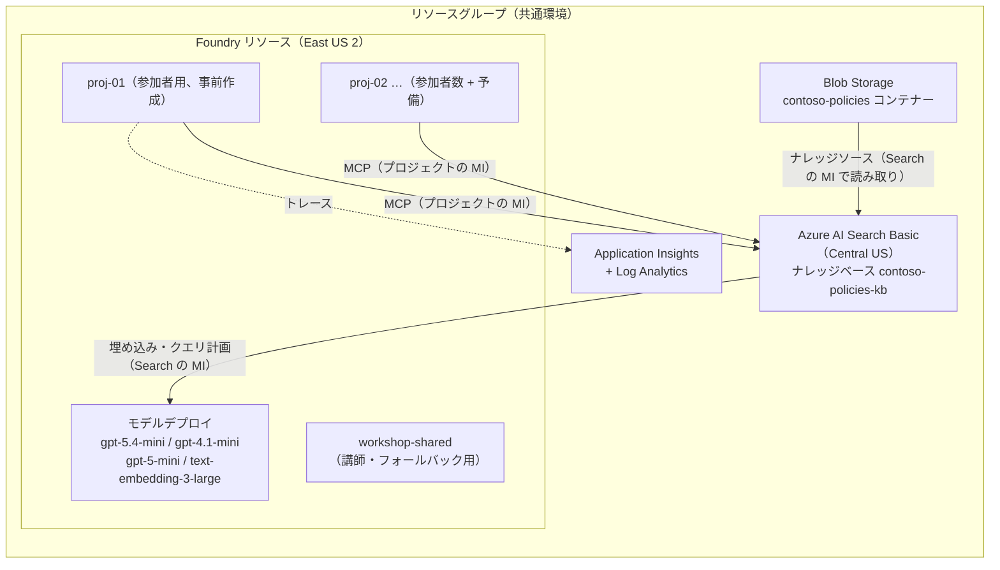

# Microsoft Foundry 入門ハンズオンワークショップ 講師ガイド（2026-09-25）

> **注意:** Foundry は機能・ポータル UI・ロール名・クォータの変更が頻繁です。本ガイドは 2026-09-25 時点の Microsoft Learn の記載に基づきます。価格・クォータは変動するため、実施前に [Azure Pricing Calculator](https://azure.microsoft.com/ja-jp/pricing/calculator/) と Foundry ポータルの **Quota** ページで最新値を確認してください。Foundry IQ（ナレッジベース）と一部のポータル機能はプレビューを含みます。

- 参加者用の手順書: [lab-guide.md](./lab-guide.md)
- 事前準備の手順（デプロイ、ナレッジベース構築、RBAC）: [setup-guide.md](./setup-guide.md)
- 事前構築用 IaC: [infra/](./infra/)
- ナレッジベース用の架空社内文書: [sample-docs/](./sample-docs/)
- Lab 3 のコード: [lab3/](./lab3/)

## 1. 概要

| 項目 | 内容 |
|---|---|
| 対象者 | Microsoft Foundry を初めて使う 1 社の社員（エンジニアと非エンジニアが混在する想定） |
| 人数 | 30 名 |
| 時間 | 90 分（講義 20 分、実習 70 分） |
| 形式 | ポータル中心。最後に Python SDK を短く体験する |
| 環境 | 講師が事前に構築した共通 Azure 環境（1 つの Foundry リソースを全員で共有） |
| 題材 | 架空企業「コントソ株式会社」の社内規程・FAQ を答える社内ヘルプデスクエージェント |

**ゴール**（参加者が終了時にできること）

1. Foundry のリソース・プロジェクト・モデルデプロイ・エージェントの関係を説明できる。
2. プレイグラウンドでモデルを試し、システムプロンプトやモデルの違いによる挙動の差を確認できる。
3. Foundry IQ のナレッジベースを接続したエージェントを作り、社内文書に基づく回答と引用を確認できる。
4. Python SDK から自分のエージェントを呼び出せる。
5. トレースで、エージェントの内部動作（ツール呼び出し、トークン数、レイテンシ）を確認できる。

## 2. 環境構成



**リージョンの選定理由**

| 観点 | 選定 | 根拠 |
|---|---|---|
| Foundry とモデル | East US 2 | Global Standard で Azure OpenAI モデル 73 件中 72 件が利用可能。Agent Service の全ツールに対応（[モデルのリージョン提供状況](https://learn.microsoft.com/azure/foundry/foundry-models/concepts/models-sold-directly-by-azure-region-availability)、[Agent Service のリージョン対応](https://learn.microsoft.com/azure/foundry/agents/concepts/limits-quotas-regions)）。代替は Sweden Central（ほぼ同等） |
| Azure AI Search | Central US | East US 2 は需要が高く、Search サービスを新規作成できない（[Search のリージョン対応](https://learn.microsoft.com/azure/search/search-region-support)）。Central US はエージェント検索とセマンティックランカーに対応している。リージョンをまたいだ構成は制限されていない（同一リージョンは推奨のみ） |

**ロール設計**（ロール名は 2026 年に改名済み。旧名: Azure AI User → Foundry User、Azure AI Owner → Foundry Owner。ロール ID は変わっていない。[Foundry の RBAC](https://learn.microsoft.com/azure/foundry/concepts/rbac-foundry)）

| プリンシパル | ロール | スコープ | 目的 |
|---|---|---|---|
| 参加者グループ | Foundry Owner（`ownProject` モード）／ Foundry User（`sharedProject` モード） | Foundry リソース | 事前作成したプロジェクトでのエージェント開発、プロジェクト接続の作成 |
| 参加者グループ | Reader | リソースグループ | ポータルでリソースを参照 |
| 参加者グループ | Search Index Data Reader | AI Search | ナレッジベースの参照 |
| 参加者グループ | Log Analytics Reader | Log Analytics | トレースの参照 |
| 講師 | Foundry Owner、Search Service Contributor、Search Index Data Contributor、Storage Blob Data Contributor | 各リソース | 環境準備、ナレッジベース構築 |
| AI Search の MI | Storage Blob Data Reader | Storage | 文書の取り込み |
| AI Search の MI | Cognitive Services User | Foundry リソース | 埋め込み・クエリ計画モデルの呼び出し |
| 各プロジェクトの MI | Foundry User | Foundry リソース | エージェント実行 |
| 各プロジェクトの MI | Search Index Data Reader | AI Search | ナレッジベース（MCP エンドポイント）の呼び出し |

- 参加者用プロジェクト（`proj-01`〜`proj-NN`）は [main.bicep](./infra/main.bicep) で事前に作成し、各プロジェクトの MI へのロール割り当て（Foundry User、Search Index Data Reader）も同時に行う。当日に講師がロールを付与する作業はない。数は参加者数に予備（2〜3 個）を足して決め、当日に参加者へ番号を割り当てる。
- 参加者グループには、プロジェクトを作成しなくても Foundry Owner が必要になる。Lab 2 の **Connect to Foundry IQ** がプロジェクトの接続を作成する（`projects/connections/write`）ためで、Foundry User にはこの権限がない。Foundry Owner ではモデルデプロイの作成・削除、プロジェクトの作成、他の参加者のプロジェクトの操作もできてしまう。当日は「デプロイとリソース設定は変更しない」「割り当てられたプロジェクト以外を使わない」と明示する。より厳しく制御したい場合は、Foundry Project Manager（モデルデプロイは変更できない。未検証）やカスタムロールを検討する。
- ナレッジベースへの接続（Azure AI Search 接続と RemoteTool 接続）は、参加者が Lab 2 の **Connect to Foundry IQ** で操作したときにポータルが自動で作成する。接続名は Foundry リソース内で一意である必要があり、同じ名前の接続をプロジェクトごとに事前作成することはできない。
- 予備が足りずに当日プロジェクトを追加した場合は、[grant-project-access.sh](./infra/scripts/grant-project-access.sh) で追加したプロジェクトの MI にロールを付与する（[setup-guide.md](./setup-guide.md) §10）。

## 3. 事前準備チェックリスト

### 3.1 1〜2 週間前

- [ ] 参加者用の Entra ID セキュリティグループを作り、30 名を追加する。オブジェクト ID を控える。
- [ ] 参加者用プロジェクトの数（参加者数 + 予備 2〜3 個）を決める。
- [ ] サブスクリプションのクォータ階層と、Global Standard の残りクォータを確認する（Foundry ポータル > **Operate** > **Quota**）。2026-05 以降、一部モデルはリージョンをまたいでサブスクリプション単位でクォータを共有する（[クォータと制限](https://learn.microsoft.com/azure/foundry/openai/quotas-limits)）。
- [ ] リソースプロバイダー `Microsoft.CognitiveServices`、`Microsoft.Search`、`Microsoft.Storage`、`Microsoft.Insights`、`Microsoft.OperationalInsights`、`Microsoft.CloudShell` が登録済みか確認する。
- [ ] 会社のテナントで Azure Cloud Shell の利用が許可されているか確認する。不可の場合、Lab 3 はローカルの VS Code とターミナルで行う（Python 3.10 以上と Azure CLI が必要）。
- [ ] 会社のプロキシや社内 PyPI フィードの要件を確認する。社内フィードが必須の場合は、Lab 3 の `pip install` 前に `PIP_INDEX_URL` を設定する手順を手順書に追記する。

### 3.2 3〜5 日前（環境構築）

環境構築の手順は [setup-guide.md](./setup-guide.md)（ワークショップ事前準備 CLI 手順）にまとめている。次の順に実行する。

1. 変数を設定し、前提条件を確認する（§3〜§4）。参加者グループには Entra ID のセキュリティグループを指定する（Microsoft 365 グループは使わない）。モデルのクォータとリソースプロバイダーもここで確認する。
2. [main.bicep](./infra/main.bicep) でデプロイする（§5）。参加者用プロジェクト `proj-01`〜`proj-NN` と、その MI へのロール割り当てもここで作成する。
3. ナレッジベースを構築する（§6）。
4. RBAC を確認し、不足分（Teams Publish 用を含む）を付与する（§7〜§9）。参加者用プロジェクトの MI の行（`project MI: proj-NN`）がすべて `OK` であることも確認する。
5. `workshop-shared` の **Agents** > **Traces** で Application Insights（IaC で作成済み）を接続する。
6. 参加者とプロジェクト名の割り当て表を作る（§5 のプロジェクト一覧を使う）。

### 3.3 リハーサル（前日まで）

参加者と同じ権限のテストユーザー（参加者グループに所属）で、以下を必ず確認する。ドキュメントだけでは確定できなかった項目です。

| # | 確認項目 | 期待結果 | だめな場合 |
|---|---|---|---|
| R1 | テストユーザーが、割り当てられたプロジェクト（例: `proj-01`）をポータルのプロジェクト一覧から開けるか | 開ける | プロジェクト一覧の画面名を手順書に合わせて修正する。表示されない場合はロールの反映を待ち、サインインし直す |
| R2 | 事前作成したプロジェクトで、エージェントの **Knowledge** > **Add** > **Connect to Foundry IQ** から、AI Search 接続（Project Managed Identity）を作成してナレッジベース `contoso-policies-kb` を追加できるか（2026-10-01 に参加者が作成したプロジェクトで確認済み。事前作成したプロジェクトでは未確認）。2 つ以上のプロジェクトで続けて試し、接続名が重複しないことも確認する | 一覧に表示され、追加できる | Lab 3 の SDK でナレッジベースを接続する方法に切り替える。または講師が画面共有で操作する |
| R3 | ナレッジベースを接続したエージェントが、規程に基づいて回答し、引用を表示するか | 「月額 3,000 円」などを引用付きで回答する | 403 の場合は MI のロールを確認し、割り当ての反映を 5〜10 分待つ |
| R4 | Cloud Shell（ストレージなし）で `pip install --user` と Lab 3 のスクリプトが動くか | 回答が表示される | ローカル環境、または講師のデモに切り替える |
| R5 | 画面名・メニュー名が手順書と一致しているか | 一致 | 手順書を修正する（ポータルの UI は頻繁に変わる） |
| R6 | 5〜10 人で同時に Lab 2 を実行しても 429 エラーが出ないか | 出ない | デプロイの容量を増やす（第 4 章） |

### 3.4 当日（開始 30 分前）

- [ ] 講師用のエージェント（`workshop-shared` の `policy-agent`）で質問し、ナレッジベースが応答することを確認する。
- [ ] 参加者に配布する情報を画面またはチャットに用意する: ポータル URL `https://ai.azure.com`、Foundry リソース名、参加者とプロジェクト名の割り当て表、Lab 3 のコード。

## 4. モデル容量（TPM）の見積もり

エージェントは 1 回の質問でモデルを複数回呼び出す（ツール呼び出しの判断と最終回答）。ナレッジベースの検索結果もプロンプトに入るため、1 ターンあたりのトークン数は通常のチャットより多くなる。

$$
TPM_{peak} = N \times r \times T_{turn} \times h
$$

| 記号 | 意味 | 想定値 |
|---|---|---|
| $N$ | 同時に操作する参加者数 | 30 |
| $r$ | 1 人あたりの質問数（回/分、ピーク時） | 1 |
| $T_{turn}$ | 1 ターンあたりのトークン数（入力・推論・出力の合計、モデル呼び出し 2 回分） | 8,000 |
| $h$ | 余裕係数 | 1.25 |

$$
TPM_{peak} = 30 \times 1 \times 8{,}000 \times 1.25 = 300{,}000
$$

| デプロイ | 用途 | 容量（1 = 1,000 TPM） |
|---|---|---|
| gpt-5.4-mini | Lab 1〜3 のメイン（エージェント） | 300 |
| gpt-4.1-mini | Lab 1 のモデル比較 | 100 |
| gpt-5-mini | ナレッジベースのクエリ計画 | 100 |
| text-embedding-3-large | 文書と検索クエリのベクトル化 | 100 |

- 1 分あたりのリクエスト数（RPM）の上限は TPM に比例する（gpt-5.4-mini と gpt-4.1-mini は 1,000 TPM あたり 1 RPM）。RPM は 1 秒または 10 秒の短い単位で評価されるため、全員が同時に送信すると上限内でも 429 が出ることがある（[クォータの管理](https://learn.microsoft.com/azure/foundry/openai/how-to/quota)）。
- 「全員で同時に送信」を指示しない。Lab 2 のテスト質問は各自のペースで進めてもらう。
- 見積もりはリハーサル（R6）の実測で補正する。トレース（Lab 4）でターンごとのトークン数を確認できる。
- Agent Service のセッション数の上限はホステッドエージェントのみが対象。本ワークショップで使うプロンプトエージェントは、モデルの TPM/RPM だけが制約になる（[Agent Service の制限](https://learn.microsoft.com/azure/foundry/agents/concepts/limits-quotas-regions#default-service-limits)）。
- 1 つの Foundry リソースに作れるプロジェクトは 250 個まで。30 名なら問題ない（[リソースの制限](https://learn.microsoft.com/azure/foundry/foundry-models/quotas-limits)）。

## 5. タイムテーブルと講師メモ

| 時間 | 内容 | 講師のポイント |
|---|---|---|
| 0:00–0:10 | オープニング、Foundry の全体像 | 次の 4 つの関係を 1 枚の図で説明する: **リソース**（課金・ネットワーク・モデルデプロイの単位）、**プロジェクト**（エージェント・ファイル・評価をまとめる作業場所）、**モデルデプロイ**、**エージェント**。サインイン確認もここで行う |
| 0:10–0:20 | Lab 0: 自分のプロジェクトを開く | 参加者とプロジェクト名の割り当て表を画面に表示する。「割り当てられたプロジェクト以外を開かない」「新しいプロジェクトやリソースを作らない」ことを強調する。Lab 0 自体は 5 分程度で終わるため、残りはサインインや権限のトラブル対応に使う |
| 0:20–0:35 | Lab 1: モデルとプレイグラウンド | 社内規程について質問させ、**モデルは社内のことを知らない**（それらしい誤答をする）ことを体験させる。これが Lab 2 の動機になる |
| 0:35–1:00 | Lab 2: ナレッジベースを使うエージェント | 引用（出典）を必ず確認させる。範囲外の質問で「わからない」と答えるかを試し、指示文（Instructions）の効果を説明する |
| 1:00–1:15 | Lab 3: Python SDK から呼び出す | コードの理解より「ポータルで作ったものがそのまま API で使える」ことを伝える。非エンジニアは講師のデモを見るだけでもよい |
| 1:15–1:25 | Lab 4: トレース、評価、ガードレール | トレースは参加者が操作する。評価とガードレールは講師のデモ。遅れている場合はこの Lab を短縮して時間を調整する |
| 1:25–1:30 | まとめ、後片付け、次のステップ | 本番利用に向けた論点（ネットワーク分離、ID、コスト管理、評価の継続）を紹介し、アンケートを依頼する |

### 5.1 プロジェクトが足りない場合

- 参加者用プロジェクトとその MI のロールは事前に準備済みのため、当日に `grant-project-access.sh` を実行する必要はない。
- 参加者が増えた場合は、予備のプロジェクト（割り当て表で未使用の番号）を割り当てる。
- 予備が足りない場合は、講師がポータル（**Manage** > **Resource details** > **Add project**）でプロジェクトを追加し、[grant-project-access.sh](./infra/scripts/grant-project-access.sh) を実行する（[setup-guide.md](./setup-guide.md) §10）。ロール割り当ての反映には最大 10 分程度かかる場合がある。Lab 2 でナレッジベースを接続するのは 0:45 頃なので、Lab 1 の間に実行すれば間に合う。

## 6. 各 Lab の正解例

Lab 2 のテスト質問と、[sample-docs](./sample-docs/) に基づく期待回答です。

| # | 質問 | 期待回答 | 出典 |
|---|---|---|---|
| 1 | テレワーク手当はいくらもらえますか？ | 月 8 日以上テレワークすると月額 3,000 円 | [テレワーク規程](./sample-docs/01_telework-policy.md) 第 7 条 |
| 2 | 大阪に 1 泊で出張します。宿泊費の上限と日当は？ | 大阪市内は宿泊費上限 15,000 円、日当 2,500 円 | [経費精算規程](./sample-docs/02_expense-policy.md) 第 5 条 |
| 3 | 勤続 3 年の有給休暇は何日付与されますか？ | 14 日 | [休暇規程](./sample-docs/03_leave-policy.md) 第 1 条 |
| 4 | ホテルで VPN がエラー E-809 になります | ネットワーク制限が原因のことが多く、テザリングで回避できる場合がある | [IT FAQ](./sample-docs/04_it-helpdesk-faq.md) Q3 |
| 5 | 在宅勤務の自宅のネット代を経費精算できますか？ | できない。テレワーク手当で補助している | 経費精算規程 第 8 条、テレワーク規程 第 7 条（複数文書の組み合わせ） |
| 6 | 社員食堂の今日のメニューは？ | 社内文書に情報がないため回答できない | （範囲外の質問） |

## 7. フォールバック: 共有プロジェクト方式

リハーサルの R1 または R2 で、参加者が事前作成したプロジェクトを使えなかった場合は、次のように切り替える。

1. `participantAccessMode` を `sharedProject`、`PARTICIPANT_PROJECT_COUNT` を `0` にして再デプロイする（作成済みの参加者用プロジェクトは削除されない）。参加者のロールは Foundry User（最小権限）になる。Foundry User はプロジェクトの接続を作成できないため、Lab 2 のナレッジベースの接続は講師が `workshop-shared` で事前に作成しておく必要がある（未検証）。
2. 参加者は全員 `workshop-shared` プロジェクトを使う。Lab 0 は「プロジェクトを開いて確認するだけ」になる。
3. エージェント名に個人のプレフィックスを付ける（例: `policy-agent-yamada`）。他人のエージェントを編集しないよう注意する。
4. Lab 4 のトレースは共有されるため、自分のエージェント名で絞り込んで見る。

## 8. トラブルシュート

| 症状 | 主な原因 | 対処 |
|---|---|---|
| ポータルでリソースや自分のプロジェクトが見えない | 参加者グループへの追加漏れ、ロールの反映待ち、割り当て表の番号の誤り | グループのメンバーと割り当て表を確認し、サインインし直す |
| 参加者が新しいプロジェクトを作成してしまった | Lab 0 で **Add project** などから作成した | 割り当てたプロジェクトに戻ってもらう。作成したプロジェクトを使い続ける場合は `grant-project-access.sh` を実行する |
| エージェントのナレッジベース呼び出しが 403 | プロジェクトの MI に Search Index Data Reader がない（後から追加したプロジェクトなど）、またはロールの反映待ち | `grant-project-access.sh` を実行し、5〜10 分待つ |
| ナレッジベース呼び出しが 400 または 404 | 接続先 URL、ナレッジベース名、API バージョンの誤り | プロジェクトの RemoteTool 接続（`kb-contoso-policies-kb-<suffix>`）のターゲット URL を確認する |
| ナレッジベース呼び出しが payment required（支払いが必要）のエラー | エージェント検索が無料プランのままで、月間の無料枠を使い切った | Azure ポータルの Search サービスで **Settings** > **Premium features** > **Knowledge retrieval** を **Standard** にする（[エージェント検索の課金](https://learn.microsoft.com/azure/search/agentic-retrieval-how-to-enable-disable)）。`main.bicep` では `standard` に設定済み |
| 429（Too Many Requests） | TPM/RPM の超過 | 数秒待って再送する。頻発する場合はデプロイの容量を増やす |
| Lab 3 で `DefaultAzureCredential failed` | Cloud Shell またはローカルで未ログイン | `az login` を実行し、`az account show` でテナントを確認する |
| Lab 3 で `pip install` が失敗する | プロキシや社内フィードの制限 | `PIP_INDEX_URL` を社内フィードに設定する。またはローカル環境に切り替える |
| Lab 3 で Python のバージョンエラー | `azure-ai-projects` の新しい版は Python 3.10 以上が必要 | `python3 --version` を確認する。3.9 の場合は `pip install "azure-ai-projects>=2.3.0,<2.4"` |
| トレースが表示されない | Application Insights が未接続 | **Agents** > **Traces** > **Connect** で IaC 作成済みの Application Insights を選ぶ |

## 9. 後片付け

- 参加者: Lab の最後に、自分のエージェントを削除してもらう（任意）。
- 講師: 終了後にリソースグループをまとめて削除する。

  ```bash
  az group delete -n rg-foundry-workshop --yes --no-wait
  ```

- Foundry リソースは削除後も一定期間「削除済み」として残る。同じ名前で作り直す場合は消去（purge）が必要。消去にはサブスクリプションスコープの Contributor が必要（[Foundry の RBAC](https://learn.microsoft.com/azure/foundry/concepts/rbac-foundry#notes-and-limitations)）。

## 10. 参考リンク

- [What is Microsoft Foundry?](https://learn.microsoft.com/azure/foundry/what-is-foundry)
- [Create a project for Microsoft Foundry](https://learn.microsoft.com/azure/foundry/how-to/create-projects)
- [Role-based access control for Microsoft Foundry](https://learn.microsoft.com/azure/foundry/concepts/rbac-foundry)
- [Deploy Foundry with a template (Bicep)](https://learn.microsoft.com/azure/foundry/how-to/create-resource-template)
- [What is Foundry IQ?](https://learn.microsoft.com/azure/foundry/agents/concepts/what-is-foundry-iq)
- [Connect a Foundry IQ knowledge base to Foundry Agent Service](https://learn.microsoft.com/azure/foundry/agents/how-to/foundry-iq-connect)
- [Create a blob knowledge source](https://learn.microsoft.com/azure/search/agentic-knowledge-source-how-to-blob)
- [Azure AI Search の制限（Basic は 15 ナレッジベース／15 ナレッジソースまで）](https://learn.microsoft.com/azure/search/search-limits-quotas-capacity)
- [Quickstart: Get started with Microsoft Foundry SDK](https://learn.microsoft.com/azure/foundry/quickstarts/get-started-code)
- [Set up tracing for agents](https://learn.microsoft.com/azure/foundry/observability/how-to/trace-agent-setup)
- [Run evaluations from the Foundry portal](https://learn.microsoft.com/azure/foundry/how-to/evaluate-generative-ai-app)
- [Create guardrails](https://learn.microsoft.com/azure/foundry/guardrails/how-to-create-guardrails)
- [Cloud Shell のエフェメラルセッション](https://learn.microsoft.com/azure/cloud-shell/get-started/ephemeral)
